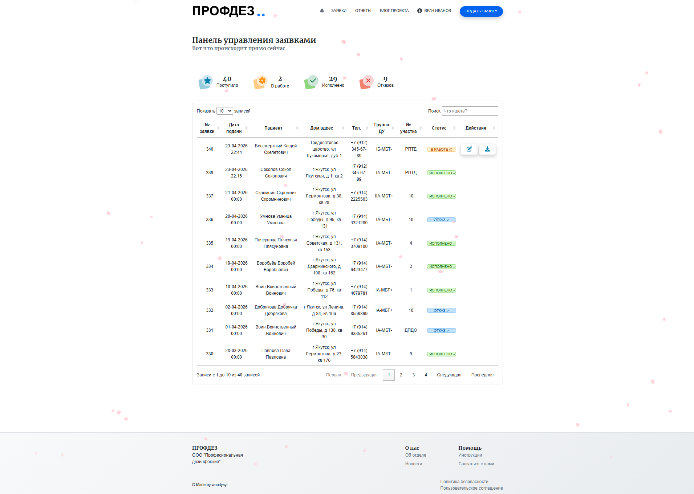
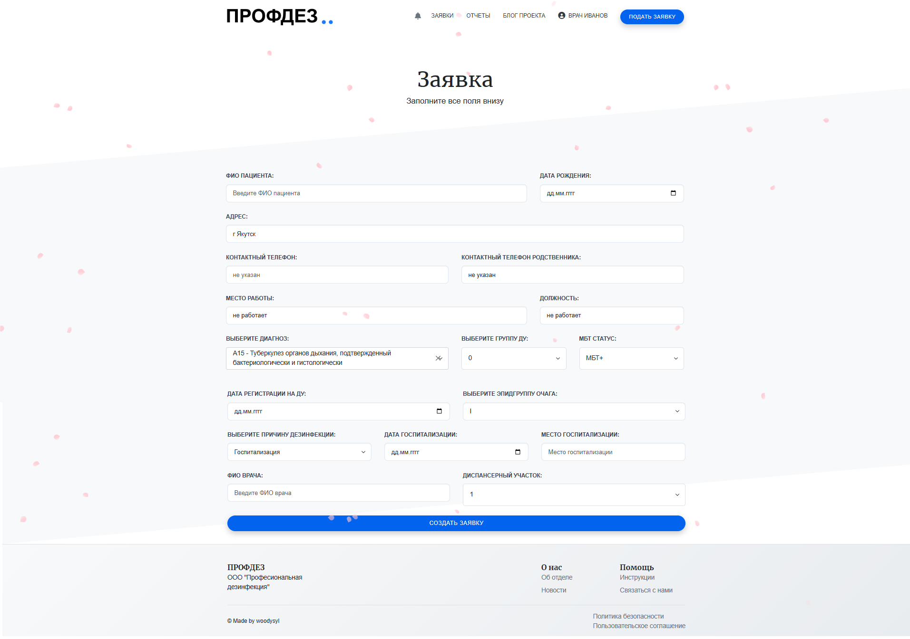
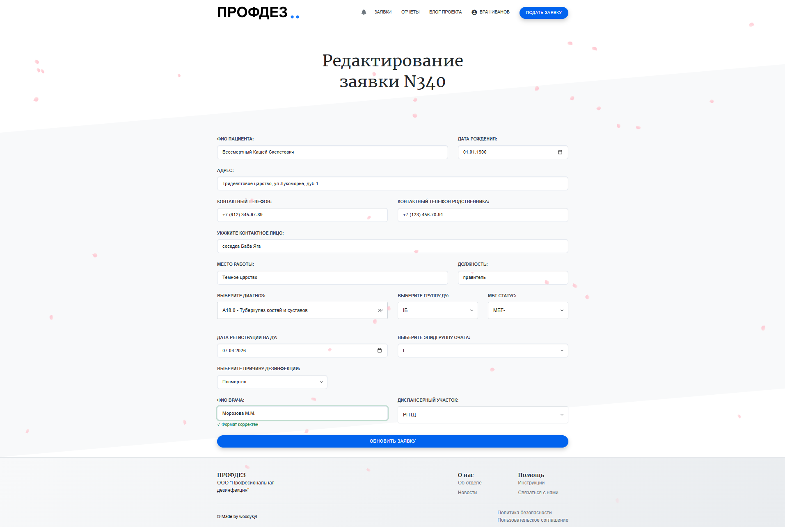

# АИС «Дезинфекция» — автоматизация учёта заявок на заключительную дезинфекцию

[](https://opensource.org/licenses/MIT)


> Это ДЕМО-версия проекта для публичного просмотра. Настоящая production-версия размещена на сервере заказчика (медицинское учреждение).
> Демонстрация оригинального продакшн-проекта — по запросу (с согласия заказчика).

**Цель проекта**: Перевести ручной процесс приёма и обработки заявок на заключительную дезинфекцию в электронный вид. Достигнутые результаты:
  - Время доставки заявки до дезинфектора: с 24 часов до ≤ 5 секунд
  - Время формирования отчётности: с нескольких часов до ≤ 5 секунд
  - Потери заявок: исключены полностью (100% учёт)

## Содержание

- [Демонстрация работы](#демонстрация-работы)
- [Аналитическая документация](#аналитическая-документация)
- [Ключевые показатели (KPI)](#ключевые-показатели-kpi-заложенные-в-процесс-to-be)
- [Возможности](#возможности)
- [REST API](#rest-api)
- [Технологический стек](#технологический-стек)
- [Архитектура проекта](#архитектура-проекта)
- [Быстрый старт](#быстрый-старт)
  - [Локальная разработка](#локальная-разработка)
  - [Production (Docker)](#production-docker)
- [Конфигурация](#конфигурация)
- [Работа с базой данных](#работа-с-базой-данных)
- [Доступ с мобильных устройств](#доступ-с-мобильных-устройств)
- [Тестирование](#тестирование)
- [Деплой](#деплой)
- [Устранение проблем](#устранение-проблем)
- [Лицензия](#лицензия)

## Демонстрация работы
>Фокус проекта — серверная логика и аналитика, фронтенд не является основной специализацией
### Ключевой сценарий: создание и обработка заявки


### Интерфейс системы

| Список заявок | Создание заявки | Просмотр и редактирование |
|---|---|---|
|  |  |  |

> **Проектное решение:** Просмотр и редактирование заявки объединены в одной форме. Это сокращает количество кликов и ускоряет работу оператора — критично для медицинского персонала с высокой загрузкой.

## Аналитическая документация

Перед началом разработки был проведён анализ бизнес-процессов и спроектирована архитектура решения.

| Артефакт | Описание | Ссылка |
|----------|----------|--------|
| **BPMN AS IS** | Процесс обработки заявок до автоматизации | [bpmn_as_is.png](docs/bpmn_as_is.png) |
| **BPMN TO BE** | Целевой процесс после внедрения | [bpmn_to_be.png](docs/bpmn_to_be.png) |
| **Требования** | Функциональные и нефункциональные требования, глоссарий, роли | [requirements.md](docs/requirements.md) |
| **User Stories** | Пользовательские истории в формате «Я как... хочу... чтобы...» | [user_stories.md](docs/user_stories.md) |
| **ER-диаграмма** | Модель базы данных | [er_diagram.png](docs/er_diagram.png) |
| **Сценарии поведения** | Создание заявки (Сотрудник диспансерного отделения) | [sequence_create_request.png](docs/uml/sequence_create_request.png) |
|  | Добавление данных дезинфекции (Дезинфектор) / отказ (дезинфектор) | [sequence_add_data_disinfection_request.png](docs/uml/sequence_add_data_disinfection_request.png) |
| **SQL-запросы** | Аналитические запросы для отчётности | [sql_queries.sql](docs/sql_queries.sql) |

## Ключевые показатели (KPI), заложенные в процесс TO BE

| Метрика | Было (AS IS) | Стало (TO BE) | Цель |
|---|---|---|---|
| Время от создания заявки до получения уведомления дезинфектором | до 24 часов (ежедневная проверка журнала) | ≤ 5 секунд (мгновенное WebSocket-уведомление) | сокращение времени реакции |
| Время формирования периодической отчётности | несколько часов (ручной сбор из трёх журналов) | ≤ 5 секунд (автоматическая генерация) | исключение ручного труда |
| Доля заявок, обработанных без потерь | риск утери бумажных записей | 100% (централизованная БД с аудитом) | обеспечение полного учёта |

## Возможности

- **Управление заявками**: создание, редактирование, удаление заявок на дезинфекцию
- **Экспорт бланка заявки**: выгрузка заполненного бланка заявки в DOCX по утвержденной форме учреждения
- **Фильтрация и поиск**: быстрый поиск и фильтрация заявок по различным параметрам
- **Статистика и отчёты**: визуализация данных, графики и аналитика
- **Мониторинг статуса**: отслеживание изменения статуса заявки (в работе, исполнен, отказ)
- **Управление пользователями**: роли (администратор, врач, дезинфектор)
- **Уведомления**: система уведомлений в реальном времени (WebSocket)
- **Блог**: публикация новостей и информационных материалов
- **Импорт/Экспорт**: работа с данными через Excel
- **Интеграция с DaData**: автоматическое заполнение адресов

## REST API
Проект предоставляет полноценный REST API для интеграции с внешними клиентами (SPA, мобильные приложения, сторонние сервисы).

**Документация:** http://localhost:8081/api/docs (Swagger UI)

**Основные эндпоинты:**

| Namespace | Эндпоинты | Описание |
|-----------|-----------|----------|
| `/api/v1/auth` | POST `/login`, `/register`, `/refresh`, `/logout` | JWT-аутентификация |
| `/api/v1/applications` | GET/POST/PATCH/DELETE | CRUD заявок с фильтрацией |
| `/api/v1/users` | GET/POST/PATCH/DELETE | Управление пользователями |
| `/api/v1/references` | GET/POST/PATCH/DELETE | Справочники (areas, doctors, diagnoses) |
| `/api/v1/notifications` | GET/PATCH/DELETE | Уведомления пользователей |
| `/api/v1/audit` | GET | Логи аудита и история изменений |
| `/api/v1/dashboard` | GET | Статистика и аналитика |
| `/api/v1/blog` | GET/POST/PATCH/DELETE | Управление постами блога |
| `/api/v1/reports` | GET | Экспорт Excel/Word |
| `/api/v1/search` | GET | Autocomplete для форм |

**Аутентификация:**
- JWT-токены (access + refresh)
- Ролевая модель (RBAC): admin, doctor, disinfector
- Blacklist токенов через Redis

**Пример запроса:**
```bash
curl -X GET "http://localhost:8081/api/v1/applications?status=incompleted&page=1&per_page=20" \
  -H "Authorization: Bearer <access_token>"
```
**Ответ:**
```json
{
  "data": {
    "items": [
      {
        "id": 1,
        "application_number": "2026-001",
        "patient_full_name": "Иванов Иван Иванович",
        "status": "incompleted",
        "submission_date": "2026-07-14T10:30:00Z"
      }
    ],
    "meta": {
      "page": 1,
      "per_page": 20,
      "total": 150,
      "pages": 8,
      "has_next": true,
      "has_prev": false
    }
  },
  "errors": null
}
```


## Технологический стек

### Backend
- **Python 3.8+**
- **Flask 2.0+** — веб-фреймворк
- **SQLAlchemy** — ORM
- **Flask-SocketIO** — WebSocket для уведомлений в реальном времени
- **Flask-Limiter** — Rate limiting для защиты от brute-force
- **Flask-Migrate** — миграции базы данных (Alembic)
- **Flask-Bcrypt** — хеширование паролей
- **Flask-RESTX** — REST API с автодокументацией (Swagger)
- **Flask-JWT-Extended** — JWT аутентификация
- **Marshmallow** — валидация и сериализация данных
- **Redis** — кэширование и blacklist токенов
- **PostgreSQL 15.5** — основная база данных

### Frontend
- **Bootstrap 5** — CSS-фреймворк
- **Jinja2** — шаблонизатор
- **Vanilla JS** — JavaScript без фреймворков
- **Chart.js** — графики и диаграммы
- **Flask-Assets** — управление статическими файлами

### Деплой и инфраструктура
- **Docker & Docker Compose** — контейнеризация
- **Nginx** — обратный прокси и раздача статики
- **uWSGI** — application server
- **Gevent** — асинхронность для SocketIO

## Архитектура проекта

```
disinfection-requests-system/
├── app/                          # Основной код приложения
│   ├── core/                     # Ядро приложения
│   │   ├── config.py            # Конфигурация
│   │   ├── extensions.py        # Инициализация расширений
│   │   ├── errors.py            # Глобальные обработчики ошибок
│   │   ├── signals.py           # Flask signals
│   │   └── bundles.py           # Flask-Assets bundles
│   ├── domain/                   # Бизнес-логика
│   │   ├── models/              # Модели данных
│   │   │   ├── user/           # Пользователи
│   │   │   ├── application/    # Заявки
│   │   │   ├── audit/          # Аудит
│   │   │   ├── blog/           # Блог
│   │   │   └── notification/   # Уведомления
│   │   └── services/            # Сервисы бизнес-логики
│   ├── routes/                   # HTTP-маршруты (Blueprints)
│   │   ├── application/        # Маршруты заявок
│   │   ├── user/               # Маршруты пользователей
│   │   ├── dashboard/          # Панель управления
│   │   ├── disinfection/       # Маршруты дезинфекции
│   │   ├── notification/       # Уведомления
│   │   ├── blog/               # Блог
│   │   ├── import_export/      # Импорт/Экспорт
│   │   └── dadata/             # Интеграция с DaData
│   ├── templates/               # Jinja2 шаблоны
│   ├── static/                  # Статические файлы
│   │   ├── css/                # Стили
│   │   ├── js/                 # JavaScript
│   │   ├── img/                # Изображения
│   │   └── upload/             # Загруженные файлы
│   └── utils/                   # Утилиты
│       ├── filters.py          # Jinja2 фильтры
│       └── serializers.py      # JSON сериализация
├── tests/                       # Тесты
├── docs/                        # Документация
├── nginx/                       # Конфигурация Nginx
├── migrations/                  # Миграции БД (Alembic)
├── .env_example                # Пример переменных окружения
├── docker-compose.yml          # Docker Compose конфигурация
├── Dockerfile                  # Docker образ
├── Makefile                    # Make команды
├── requirements.txt            # Python зависимости
├── pyproject.toml             # Метаданные проекта
├── run.py                      # Точка входа
└── README.md                   # Этот файл
```

## Быстрый старт

### Локальная разработка

**Предварительные требования:**
- Python 3.8+
- PostgreSQL 15+
- Make (опционально, для удобства)

**1. Подготовьте окружение:**

```bash
# Создание виртуального окружения
python -m venv venv
source venv/bin/activate  # Linux/macOS
# или
venv\Scripts\activate  # Windows

# Установка зависимостей
make dev-install
# или
pip install -r requirements.txt
```

**2. Настройте базу данных:**

```bash
# Запуск PostgreSQL (через Docker)
make dev-db-up
# или вручную настройте PostgreSQL и обновите .env
```

**3. Создайте файл конфигурации:**

```bash
cp .env_example .env
# Отредактируйте .env, указав ваши параметры
```

**4. Примените миграции:**

```bash
flask db upgrade
```

**5. Запустите приложение:**

```bash
make dev
# или
FLASK_ENV=development flask run --host=0.0.0.0 --port=8081
```

Приложение доступно по адресу: http://localhost:8081

**REST API документация:** http://localhost:8081/api/docs

### Production (Docker)

**Предварительные требования:**
- Docker
- Docker Compose

**1. Настройте конфигурацию:**

```bash
cp .env_example .env
# Отредактируйте .env для production
```

**2. Запустите контейнеры:**

```bash
# Запуск
make prod
# или
docker-compose up -d

# Пересборка и запуск
make prod-build
# или
docker-compose up -d --build
```

**3. Проверьте логи:**

```bash
make prod-logs
# или
docker-compose logs -f flask
```

Приложение доступно по адресу: http://localhost:8081

## Конфигурация

### Переменные окружения (.env)

Скопируйте `.env_example` в `.env` и настройте параметры:

**PostgreSQL:**
```bash
POSTGRES_USER=postgres              # Пользователь БД
POSTGRES_PASSWORD=your_password     # Пароль БД
POSTGRES_HOST=localhost             # Хост БД
POSTGRES_PORT=5432                  # Порт БД
POSTGRES_DB=disinfection_db         # Имя БД
```

**Flask:**
```bash
FLASK_APP=app                       # Имя приложения
SECRET_KEY=your_secret_key          # Секретный ключ (сгенерируйте!)
FLASK_ENV=development               # Режим (development/production)
```

**CORS:**
```bash
CORS_ALLOWED_ORIGINS=*              # Разрешённые источники
                                    # В production укажите конкретные домены
```

**Администратор:**
```bash
ADMIN_PASSWORD=your_admin_password  # Пароль администратора
                                    # Если не задан — будет сгенерирован
```

**DaData API (опционально):**
```bash
DADATA_API_KEY=your_dadata_key      # API ключ DaData
```

### Безопасность

- **Никогда не коммитьте `.env` в git**
- В production используйте сложные пароли и секретные ключи
- Ограничьте `CORS_ALLOWED_ORIGINS` конкретными доменами
- Регулярно обновляйте зависимости

## Работа с базой данных

### Миграции (Alembic)

```bash
# Создать новую миграцию
flask db migrate -m "Описание изменений"

# Применить миграции
flask db upgrade

# Откатить последнюю миграцию
flask db downgrade

# История миграций
flask db history
```

### Команды Makefile

```bash
# Подключение к PostgreSQL через psql
make psql

# Полный сброс БД (удалит все данные!)
make db-reset
```

### Создание таблиц вручную (только development/testing)

В режиме `development` или `testing` таблицы создаются автоматически при запуске.

В production используйте только Flask-Migrate.

## Доступ с мобильных устройств

Для доступа к приложению с мобильных устройств в той же локальной сети:

**1. Узнайте IP вашего компьютера:**

Linux:
```bash
ip addr show | grep "inet " | grep -v 127.0.0.1
```

Windows:
```cmd
ipconfig
```

macOS:
```bash
ifconfig | grep "inet "
```

**2. Настройте CORS:**

В `.env` укажите:
```bash
CORS_ALLOWED_ORIGINS=*
```

**3. Запустите сервер:**

```bash
make dev
```

**4. Откройте на мобильном:**

```
http://<IP_КОМПЬЮТЕРА>:8081
```

**Важно:**
- НЕ используйте `localhost` или `127.0.0.1` на мобильном устройстве
- Компьютер и мобильное устройство должны быть в одной Wi-Fi сети
- Файрвол должен разрешать входящие подключения на порт 8081

## Тестирование

**Запуск тестов:**

```bash
# Все тесты
pytest

# С подробным выводом
pytest -v

# С измерением покрытия
pytest --cov=app

# Конкретный файл
pytest tests/test_user_service.py
```

**Структура тестов:**
- `tests/conftest.py` — фикстуры и конфигурации
- `tests/test_user_service.py` — тесты сервиса пользователей
- Дополнительные тесты по мере добавления

## Деплой

### Docker Compose архитектура

```
┌─────────────┐
│   Nginx     │ :8081 -> :80
│  (reverse   │
│   proxy)    │
└──────┬──────┘
       │
       ▼
┌─────────────┐
│    Flask    │ :8081 (uWSGI)
│  (app +     │
│  SocketIO)  │
└──────┬──────┘
       │
       ▼
┌─────────────┐
│ PostgreSQL  │ :54321 -> :5432
│  (database) │
└─────────────┘
```

### Production checklist

- [ ] Установить сложный `SECRET_KEY`
- [ ] Установить сложный `ADMIN_PASSWORD`
- [ ] Ограничить `CORS_ALLOWED_ORIGINS`
- [ ] Настроить backup базы данных
- [ ] Настроить мониторинг
- [ ] Включить HTTPS (Let's Encrypt)
- [ ] Обновить все зависимости
- [ ] Проверить логи на ошибки

### Обновление приложения

```bash
# Pull новых изменений
git pull

# Пересборка и запуск
make prod-build

# Применение миграций БД
docker-compose exec flask flask db upgrade
```

## Устранение проблем

### Ошибка 429 (Too Many Requests)

**Причина:** Срабатывает rate limiting при входе в систему.

**Решение:**
- Лимит увеличен до 20 запросов в минуту
- Подождите 1 минуту и попробуйте снова
- Проверьте, не используете ли вы неправильный пароль

### Не могу подключиться с мобильного

**Причина:** `localhost` на мобильном = само мобильное устройство.

**Решение:**
1. Используйте IP компьютера в локальной сети
2. Убедитесь, что `CORS_ALLOWED_ORIGINS=*` в `.env`
3. Проверьте файрвол: `sudo ufw allow 8081/tcp`

### Ошибка подключения к БД

**Причина:** PostgreSQL не запущен или недоступен.

**Решение:**
```bash
# Проверить статус
make dev-db-up

# Перезапустить
make db-reset
```

### Ошибка при запуске: ModuleNotFoundError

**Причина:** Не установлены зависимости.

**Решение:**
```bash
source venv/bin/activate
pip install -r requirements.txt
```

### SocketIO не работает

**Причина:** Неправильная конфигурация CORS или транспорта.

**Решение:**
- В development: `CORS_ALLOWED_ORIGINS=*`
- SocketIO использует long-polling (не WebSocket)
- Проверьте логи на ошибки

### Веб-ассеты не компилируются

**Причина:** Проблемы с Flask-Assets.

**Решение:**
```bash
# Очистить кэш
rm -rf app/static/.webassets-cache/
rm -rf app/static/gen/

# Перезапустить приложение
make dev
```

## Дополнительная документация

- [docs/](docs/) — Техническая документация

## Лицензия

MIT License. См. [LICENSE](LICENSE) для подробностей.

## Поддержка

По вопросам поддержки и сотрудничества обращайтесь к документации проекта или создайте Issue в репозитории.
