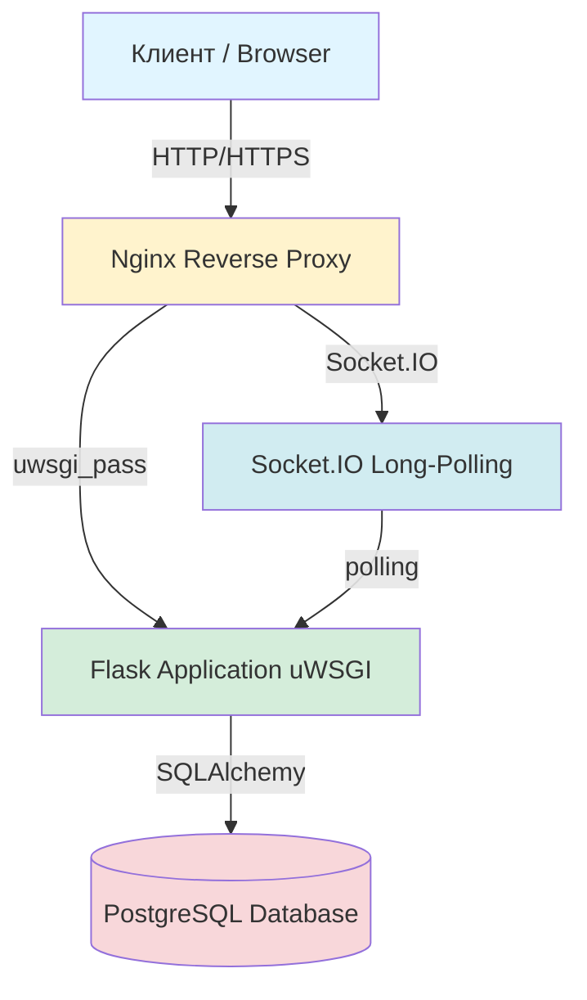
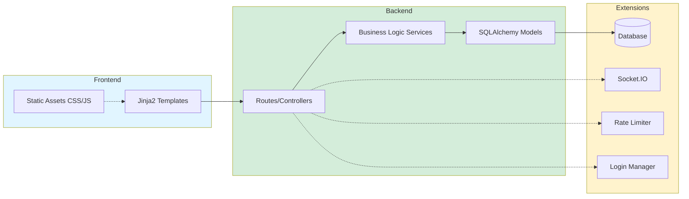
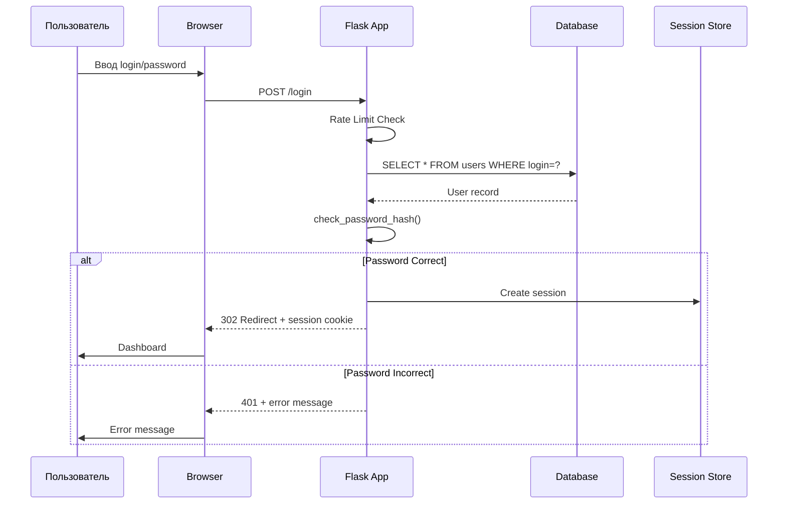

# Техническая документация

## Содержание

- [Архитектура приложения](#архитектура-приложения)
- [Модели данных](#модели-данных)
- [Проектные решения и компромиссы нормализации](#проектные-решения-и-компромиссы-нормализации)
- [Сервисы](#сервисы)
- [Маршруты и контроллеры](#маршруты-и-контроллеры)
- [Безопасность](#безопасность)
- [WebSocket и уведомления](#websocket-и-уведомления)
- [Rate Limiting](#rate-limiting)
- [Миграции базы данных](#миграции-базы-данных)
- [Логирование](#логирование)
- [Тестирование](#тестирование)

## Архитектура приложения

Приложение построено на базе Flask с использованием модульной архитектуры:

### Слои приложения

```
┌─────────────────────────────────────┐
│         Routes (Controllers)        │
│   Обработка HTTP-запросов, рендер   │
├─────────────────────────────────────┤
│      Services (Business Logic)      │
│   Бизнес-логика, валидация, CRUD    │
├─────────────────────────────────────┤
│     Models (Data Layer / ORM)       │
│   Модели данных, SQLAlchemy entities│
├─────────────────────────────────────┤
│      Database (PostgreSQL)          │
│   Хранение данных                   │
└─────────────────────────────────────┘
```

### Архитектура развертывания



### Компоненты системы



### Инициализация приложения

**Файл:** `app/__init__.py`

Функция `create_app()` реализует паттерн Application Factory:

1. Создание Flask-приложения
2. Загрузка конфигурации
3. Регистрация шаблонов и фильтров
4. Регистрация Blueprint'ов (маршруты)
5. Инициализация расширений (db, migrate, login_manager, socketio, limiter, assets)
6. Настройка обработчиков SocketIO
7. Регистрация Flask signals
8. Регистрация обработчиков ошибок
9. Создание таблиц/применение миграций
10. Инициализация администратора и справочников

### Расширения

**Файл:** `app/core/extensions.py`

Все расширения инициализируются без параметров, затем подключаются к app через `init_app()`:

- `db` — SQLAlchemy (ORM)
- `migrate` — Flask-Migrate (Alembic)
- `bcrypt` — Flask-Bcrypt (хеширование)
- `login_manager` — Flask-Login (аутентификация)
- `assets` — Flask-Assets (управление статикой)
- `socketio` — Flask-SocketIO (WebSocket)
- `limiter` — Flask-Limiter (rate limiting)

## Модели данных

### Список моделей по модулям

**Модуль `application` (`app/domain/models/application/entities.py`)**
- `Area` – диспансерные участки
- `Doctor` – врачи (привязаны к участку)
- `Disinfector` – дезинфекторы
- `Diagnosis` – справочник диагнозов (МКБ)
- `EpidemicFocus` – эпидемические очаги
- `ApplicationCounter` – счётчик номеров заявок по годам
- `Application` – основная заявка на дезинфекцию
- `Disinfection` – выполненная дезинфекция (связана с заявкой один-к-одному)

**Модуль `audit` (`app/domain/models/audit/entities.py`)**
- `ApplicationAuditLog` – аудит изменений заявок
- `UserAuditLog` – аудит действий пользователей (вход, выход, смена пароля, удаление пользователя)

**Модуль `blog` (`app/domain/models/blog/entities.py`)**
- `BlogPost` – посты блога

**Модуль `notification` (`app/domain/models/notification/entities.py`)**
- `Notification` – уведомления пользователей

**Модуль `user` (`app/domain/models/user/entities.py`)**
- `User` – пользователи системы (администраторы, врачи, дезинфекторы)

```mermaid
erDiagram
    User ||--o{ Application : "создаёт"
    User ||--o{ Notification : "получает"
    User ||--o{ Disinfection : "выполняет"
    User ||--o{ UserAuditLog : "действие"
    User ||--o{ ApplicationAuditLog : "изменяет"

    Area ||--o{ Doctor : "содержит"
    Area ||--o{ Application : "относится к"

    Doctor ||--o{ Application : "назначен"

    Diagnosis ||--o{ Application : "диагноз"
    EpidemicFocus ||--o{ Application : "очаг"

    Application ||--|| Disinfection : "имеет"
    Application ||--o{ ApplicationAuditLog : "журнал изменений"

    Disinfection }o--o{ Disinfector : "участвуют"

    ApplicationCounter {
        int year PK
        int last_number
    }

    BlogPost {
        int id PK
        string title
        text content
        string image
        text excerpt
        datetime created_at
        datetime updated_at
        bool is_published
    }

    Notification {
        int id PK
        int user_id FK
        string title
        text message
        string notification_type
        bool is_read
        datetime created_at
        string related_entity_type
        int related_entity_id
    }

    User {
        int id PK
        string login
        string name
        string password_hash
        string user_type
    }

    Area {
        int id PK
        string name_area
    }

    Doctor {
        int id PK
        string full_name
        int area_id FK
    }

    Disinfector {
        int id PK
        string full_name
    }

    Diagnosis {
        int id PK
        string mkb_code
        string name
    }

    EpidemicFocus {
        int id PK
        string name
    }

    Application {
        int id PK
        int application_number
        datetime submission_date
        string patient_full_name
        date birth_date
        string address
        string contact_phone
        string relative_contact_phone
        string workplace
        string position
        date registration_date
        int diagnosis_id FK
        string gdu
        int focus_id FK
        string reason_application
        string status
        int user_id FK
        int doctor_id FK
        string doctor_full_name
        int area_id FK
        date hospitalization_date
        string place_of_hospitalization
    }

    Disinfection {
        int id PK
        int application_id FK
        string rejection_reason
        datetime disinfection_date
        float area_size
        float volume_size
        string spraying_time
        int swab_testing
        int user_id FK
    }

    ApplicationAuditLog {
        int id PK
        int application_id
        int changed_by
        datetime change_time
        string change_type
        json old_data
        json new_data
    }

    UserAuditLog {
        int id PK
        int user_id
        string action
        datetime action_time
        json details
    }
```



### Описание ключевых моделей

#### User (Пользователь)
- **Роли:** 
    - `admin` — полный доступ, управление пользователями,
    - `doctor` — создание и управление заявками, 
    - `disinfector` — обработка заявок на дезинфекцию, статистика и выгрузка отчетности в Word и заявок в Excel.
- `login` – уникальный логин
- `password_hash` – хеш bcrypt

#### Application (Заявка)
- Содержит все данные о пациенте, адресе, диагнозе и враче.
- `application_number` – сквозной номер в пределах года (генерируется через `ApplicationCounter`).
- `status` – `incompleted`, `completed`, `refusal`.
- Связана с `User` (кто создал), `Doctor` (лечащий врач), `Area` (участок).

#### Disinfection (Дезинфекция)
- Создаётся автоматически при создании заявки.
- Содержит результаты обработки: площадь, объём, время, список дезинфекторов.
- `rejection_reason` – если не `completed`, то причина отказа.

#### ApplicationAuditLog и UserAuditLog
- `ApplicationAuditLog` заполняется через SQLAlchemy events (`after_insert`, `after_update`).
- `UserAuditLog` – через Flask signals (вход, выход) и вручную при изменении пароля/удалении.

#### Notification (Уведомление)
- `notification_type` – `new_application`, `status_update` и т.д.
- `related_entity_type` / `related_entity_id` – ссылка на заявку или другую сущность.
- Используется для real-time уведомлений через SocketIO.

## Проектные решения и компромиссы нормализации

### 1. Денормализация `doctor_full_name` в `application`
Поле `doctor_full_name` дублирует данные из `doctor.full_name`. Это сделано намеренно для сохранения исторической точности: при изменении фамилии врача в справочнике ранее созданные заявки продолжают отображать актуальное на момент создания имя. Альтернатива (хранение только `doctor_id`) потребовала бы либо блокировки редактирования врачей, либо сложной логики версионирования.

### 2. Отсутствие отдельной сущности `Patient`
Данные пациента хранятся непосредственно в заявке. В условиях пилотного внедрения в одном учреждении это упростило разработку и ускорило запуск. При масштабировании на несколько диспансеров или появлении повторных заявок от одних и тех же пациентов рекомендуется выделить таблицу `patient` и связать её с `application` через `patient_id`.

### 3. Отсутствие отдельной сущности `Address`
Текущая схема отражает реальный бизнес-процесс: адрес очага может уточняться при каждой заявке. При переходе к централизованному учёту очагов целесообразно вынести в отдельную сущность `address`, а в заявке оставить возможность переопределения (например, поле `address_id`).

### Фронтенд: Jinja2 (SSR) вместо React/Vue (SPA)

**Решение:** Фронтенд реализован через Jinja2 + Bootstrap 5 (server-side rendering).

**Почему:**
- Минимизация time-to-market для медицинского учреждения с ограниченным бюджетом
- Быстрый запуск MVP без найма фронтенд-разработчика
- Простота поддержки медицинским персоналом (не нужен JS-фреймворк)

**Планы на будущее:**
При масштабировании системы на несколько учреждений планируется миграция на SPA (React/Vue) с выделением фронтенда в отдельный репозиторий.

### REST API как самостоятельный слой

**Решение:** REST API (`app/api/v1/`) разработан параллельно с SSR-фронтом (`app/routes/`), но **не интегрирован** с ним.

**Почему:**
- API спроектирован как самостоятельный продукт для будущих SPA-клиентов
- SSR-фронт использует прямые вызовы Flask-маршрутов (быстрее для MVP)
- API готов к использованию мобильными приложениями и внешними интеграциями

**Статус:**
- API полностью функционален и задокументирован (Swagger UI at `/api/docs`)
- JWT-аутентификация, RBAC, пагинация, фильтры
- Не интегрирован с текущим Jinja2-фронтом (осознанное архитектурное решение)

### Backend: Flask вместо FastAPI/Django

**Решение:** Flask выбран как быстрый в прототипировании фреймворк для MVP.

**Почему:**
- Минимальный overhead для небольшого проекта
- Гибкость в выборе библиотек (SQLAlchemy, Flask-SocketIO, Flask-RESTX)
- Простота деплоя (uWSGI + Nginx)

**Планы на будущее:**
При росте нагрузки возможна миграция на FastAPI (асинхронность) или Django (встроенная админка).


## Сервисы

### UserService

**Файл:** `app/domain/services/user_service.py`

Отвечает за управление пользователями:

- `create_user(user_data)` — создание нового пользователя
- `update_user(user_id, update_data)` — обновление данных
- `delete_user(user_id)` — удаление пользователя
- `UserInitializer.create_admin_account()` — создание администратора при первом запуске
- `UserInitializer.fill_directories()` — заполнение справочников

### NotificationService

**Файл:** `app/domain/services/notification_service.py`

Управление уведомлениями:

- `create_notification(user_id, message)` — создание уведомления
- `get_unread_count(user_id)` — количество непрочитанных
- `mark_as_read(notification_id)` — отметить как прочитанное
- `setup_socket_handlers()` — настройка WebSocket событий

### ExcelImportExportService

**Файл:** `app/domain/services/import_export_service.py`

Импорт и экспорт данных:

- `export_applications_to_excel()` — экспорт заявок в Excel
- `import_from_excel(file)` — импорт данных из Excel

## Маршруты и контроллеры

Все маршруты организованы через Flask Blueprints:

### Основные маршруты

| Blueprint | URL Prefix | Описание | Файл |
|-----------|-----------|----------|------|
| `user` | `/` | Аутентификация, регистрация, управление пользователями | `app/routes/user/routes.py` |
| `application` | `/` | CRUD заявок | `app/routes/application/routes.py` |
| `disinfection` | `/` | Управление дезинфекцией | `app/routes/disinfection/routes.py` |
| `dashboard` | `/admin` | Административная панель, статистика | `app/routes/dashboard/routes.py` |
| `notification` | `/` | Уведомления | `app/routes/notification/routes.py` |
| `blog` | `/blog` | Блог | `app/routes/blog/routes.py` |
| `import_export` | `/import-export` | Импорт/экспорт Excel | `app/routes/import_export/routes.py` |
| `dadata` | `/api/dadata` | API DaData (автодополнение адресов) | `app/routes/dadata/routes.py` |

### Защита маршрутов

- `@login_required` — требуется аутентификация
- Проверка `current_user.user_type == 'admin'` — только для администраторов
- `abort(403)` — запрет доступа

## Безопасность

### Процесс аутентификации



### Аутентификация

**Механизм:** Flask-Login + Flask-Bcrypt

1. Пользователь вводит login/password
2. Проверка через `check_password_hash()`
3. При успехе — `login_user(user)`
4. Сессия хранится в cookie (secured by SECRET_KEY)

### Хеширование паролей

**Алгоритм:** bcrypt

```python
from werkzeug.security import generate_password_hash, check_password_hash

# Создание хеша
password_hash = generate_password_hash(password)

# Проверка
check_password_hash(password_hash, input_password)
```

### Rate Limiting

**Библиотека:** Flask-Limiter

**Защита login:**
```python
@user.route('/login')
@limiter.limit("20 per minute")
def login():
    ...
```

**Обработчик 429:**
- Показывает сообщение с временем ожидания
- Работает для API и web-интерфейса

### CORS

**Конфигурация:** SocketIO CORS

- Development: `['*']` — разрешены все источники
- Production: конкретные домены из `.env`

## WebSocket и уведомления

### Технология

**Библиотека:** Flask-SocketIO  
**Режим:** long-polling (не WebSocket upgrade)  
**Причина:** Совместимость с uWSGI

### Конфигурация

```python
socketio.init_app(
    app,
    cors_allowed_origins=['*'],  # dev
    async_mode='gevent',
    transports=['polling'],       # long-polling
    ping_timeout=60,
    ping_interval=25
)
```

### События

**Клиент → Сервер:**
- `connect` — подключение
- `disconnect` — отключение

**Сервер → Клиент:**
- `notification` — новое уведомление
- `notification_count` — обновление счётчика

### Обработчики

**Файл:** `app/domain/services/notification_service.py`

```python
@socketio.on('connect')
def handle_connect():
    # Аутентификация пользователя
    # Отправка непрочитанных уведомлений
    ...

@socketio.on('disconnect')
def handle_disconnect():
    # Очистка ресурсов
    ...
```

## Rate Limiting

### Конфигурация

**Файл:** `app/core/extensions.py`

```python
limiter = Limiter(key_func=get_remote_address)
```

**Хранилище:** memory (development) или Redis (production)

### Лимиты

| Маршрут | Лимит | Описание |
|---------|-------|----------|
| `/login` | 20/мин | Защита от brute-force |
| Остальные | Без лимита | — |

### Обработка 429

**Файл:** `app/core/errors.py`

```python
@app.errorhandler(429)
def ratelimit_handler(error):
    retry_after = error.description
    return jsonify({
        'error': 'Too many requests',
        'retry_after': retry_after
    }), 429
```

## Миграции базы данных

### Инструмент

**Flask-Migrate** (Alembic wrapper)

### Команды

```bash
# Инициализация (однократно)
flask db init

# Создать миграцию
flask db migrate -m "Описание"

# Применить
flask db upgrade

# Откатить
flask db downgrade
```

### Структура миграций

```
migrations/
├── versions/
│   ├── 001_initial.py
│   ├── 002_add_users.py
│   └── ...
├── alembic.ini
└── env.py
```

### Best Practices

- **Никогда не редактировать** применённые миграции
- **Всегда создавать** новую миграцию для изменений
- **Тестировать** upgrade и downgrade
- **Коммитить** файлы миграций в git

## Логирование

### Конфигурация

```python
import logging

logger = logging.getLogger(__name__)
```

### Уровни

- `logger.info()` — информационные сообщения
- `logger.error()` — ошибки с traceback
- `logger.warning()` — предупреждения

### Примеры использования

```python
try:
    UserService.create_user(user_data)
except Exception as e:
    logger.error(f'Ошибка при регистрации: {str(e)}')
    flash('Ошибка при регистрации', 'danger')
```

### Логирование в production

В production рекомендуется настроить:
- File handler для записи в лог-файлы
- RotatingFileHandler для ротации логов
- Отправку критичных ошибок на email/Sentry

## Тестирование

### Фреймворк

**pytest** с фикстурами из `conftest.py`

### Фикстуры

```python
@pytest.fixture
def app():
    """Создание тестового приложения с SQLite in-memory"""
    app = create_app(config_class=TestConfig)
    with app.app_context():
        db.create_all()
    return app

@pytest.fixture
def client(app):
    """Тестовый клиент Flask"""
    return app.test_client()

@pytest.fixture
def test_user(db_session):
    """Тестовый пользователь"""
    ...

@pytest.fixture
def admin_user(db_session):
    """Тестовый администратор"""
    ...
```

### Тестовая конфигурация

**Файл:** `tests/conftest.py`

```python
class TestConfig:
    TESTING = True
    SQLALCHEMY_DATABASE_URI = 'sqlite:///:memory:'
    WTF_CSRF_ENABLED = False
    FLASK_ENV = 'testing'
    RATELIMIT_STORAGE_URL = 'memory://'
```

### Запуск тестов

```bash
# Все тесты
pytest

# Подробный вывод
pytest -v

# С покрытием
pytest --cov=app --cov-report=html

# Один файл
pytest tests/test_user_service.py -v
```

### Покрытие кода

Требуется: `pytest-cov`

```bash
pip install pytest-cov
pytest --cov=app --cov-report=html
```

Отчёт будет в `htmlcov/index.html`

### Написание тестов

**Пример:**

```python
def test_login_success(self, client, test_user, app):
    """Test successful login."""
    response = client.post('/login', data={
        'login': 'testuser',
        'password': 'testpass123'
    }, follow_redirects=True)
    
    assert response.status_code == 200
    assert b'Вы вошли в систему!' in response.data
```

**Структура теста:**
1. Arrange — подготовка данных
2. Act — выполнение действия
3. Assert — проверка результатов

---

**Дата последнего обновления:** 14 апреля 2026